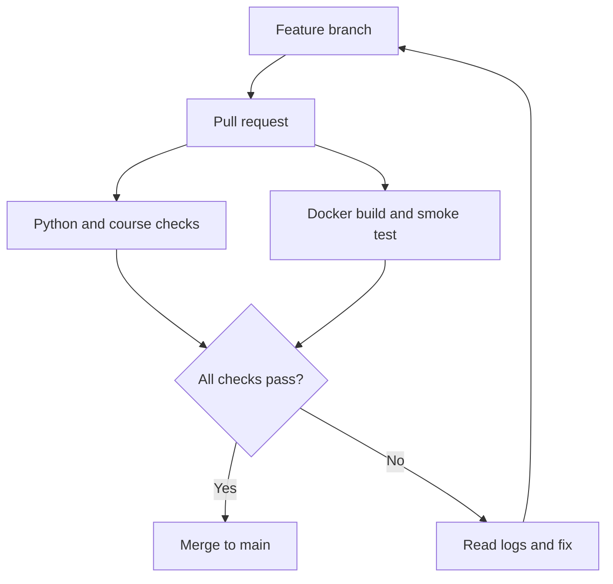

<p align="center"></p>

<p align="center"><a href="https://github.com/svrforge/devops-first-pipeline/actions/workflows/ci.yml"></a> · <strong>English by default</strong> · <a href="docs/ta/README.md">தமிழ்</a> · <a href="LICENSE">MIT</a></p>

# One path. Real practice. Evidence at every step.

**Learn DevOps from zero by operating one small service from your laptop to CI, containers and a local Kubernetes cluster.** No cloud bill to begin. No Python packages to install. Every module has an explanation, commands, expected evidence, a failure exercise and a knowledge check.

<table><tr><td><strong>01 / UNDERSTAND</strong><br>Short explanations before tools.</td><td><strong>02 / BUILD</strong><br>Run commands and inspect outcomes.</td><td><strong>03 / RECOVER</strong><br>Diagnose a failure and prove the fix.</td></tr></table>

## Choose your starting point

| You are here | Start here |
|---|---|
| I have never used DevOps tools | **[Start here — setup in small steps](START-HERE.md)** |
| I want the complete learning path | [12-module English course](docs/en/README.md) |
| எனக்கு தமிழில் விளக்கம் வேண்டும் | [தமிழ் concept guides](docs/ta/README.md) |
| I learn by building | [Run the first project](docs/FIRST-PROJECT.md) |
| I want a daily structure | [30-day practice plan](docs/30-DAY-PLAN.md) |
| I want to prove my skills | [Three capstones and evidence rubric](capstones/README.md) |

## Your offline learning companion

```bash
git clone https://github.com/svrforge/devops-first-pipeline.git
cd devops-first-pipeline
python learn.py
python learn.py doctor
python learn.py lesson 01
```

```bash
python learn.py --lang ta lesson 01  # Tamil concept explanation
python learn.py quiz 01             # Knowledge check, with feedback
python learn.py complete 01         # Record your own lab completion
python learn.py next                # Continue from local progress
```

The companion **displays commands; it never runs them for you**. Progress stays in an ignored local JSON file. It is self-reported, not a certificate. English is the default throughout. Tamil covers module concepts and navigation; technical commands, detailed exercises and quizzes remain English so commands are consistent. [Translation scope and contribution guide](docs/LANGUAGES.md).

## The curriculum

| Level | Modules | You will demonstrate |
|---|---|---|
| **Foundation** | [01 Mindset](docs/en/01.md) · [02 Linux](docs/en/02.md) · [03 Git](docs/en/03.md) · [04 Networking](docs/en/04.md) | Understand a process, inspect a request, propose a change |
| **Build & deliver** | [05 Python/tests](docs/en/05.md) · [06 Docker](docs/en/06.md) · [07 CI](docs/en/07.md) · [08 Jenkins](docs/en/08.md) | Test behavior, build an image, verify a pipeline |
| **Operate** | [09 Kubernetes](docs/en/09.md) · [10 Terraform](docs/en/10.md) · [11 Incidents](docs/en/11.md) · [12 Security/capstone](docs/en/12.md) | Diagnose, recover, plan infrastructure, explain risk |

## What is included

- **Working project:** Python HTTP service, real HTTP tests, non-root Docker image, hardened local Compose configuration.
- **Learning experience:** 12 English lessons + 12 Tamil concept companions, offline navigator, quizzes, local progress and setup checks.
- **Hands-on extensions:** Jenkins pipeline, named-context kind deployment, provider-free Terraform state lab, HTTP observation script, incident template.
- **Portfolio evidence:** three capstone rubrics, daily practice plan, contribution and PR templates.
- **Quality gates:** Python 3.11/3.12/3.13 tests, course/translation/link checks, Docker build and live-container smoke test. Weekly dependency update PRs.

## How a change reaches main



CI reports failures honestly; a green badge is evidence of the configured checks only. Jenkins, kind and Terraform walkthroughs are additional labs, not claims of deployed production infrastructure. See [CI and maintenance](docs/CI.md).

## Build your first proof today

```bash
python -m unittest discover -s tests -v
python scripts/validate_course.py
python app.py
```

Open <http://localhost:8000/health>. Expected: `{"status": "ok"}`. Stop with Ctrl+C. Then move to Docker when ready — you do not need every tool installed on day one.

## Learn safely, contribute clearly

This is an educational service using Python's built-in HTTP server, not a production web stack. The default path uses local resources; the [OCI guide](docs/CLOUD.md) is a planning exercise. Never use work clusters or commit secrets/state. [Troubleshooting](docs/TROUBLESHOOTING.md) · [Contributing](CONTRIBUTING.md) · [Security](SECURITY.md).

Built and maintained under **SVR Forge · Vignesh Raja Sundararajan**. The goal is practical understanding, not a promise of mastery in a fixed number of days.
