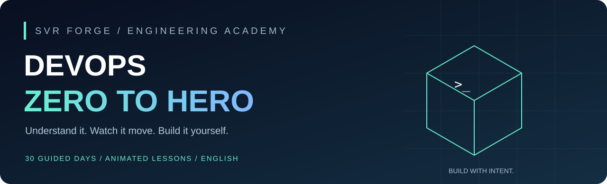

<p align="center"></p>

<p align="center"><a href="https://svrforge.github.io/devops-first-pipeline/"><strong>OPEN THE ANIMATED CLASSROOM ↗</strong></a> · <a href="docs/en/README.md">Read the 30-day course</a> · <a href="START-HERE.md">Setup guide</a></p>

[](https://github.com/svrforge/devops-first-pipeline/actions/workflows/ci.yml)

# DevOps, one day at a time.

**Day 1 starts with a food-order app. No coding, installation or tool names to memorize.**

A free, English-only learning experience from **SVR Forge · Vignesh Raja Sundararajan**. Learn by taking one small HTTP service from your laptop through Git, tests, containers, CI, local Kubernetes, infrastructure state and incident recovery.

## This is a classroom you can use

| Inside every day | What you do |
|---|---|
| **Understand** | Read a clear concept and a familiar real-world analogy |
| **Watch the walkthrough** | Play/pause four animated steps, change speed or inspect each step manually |
| **Try it yourself** | Copy commands, follow prerequisites, compare the actual result with expected evidence |
| **Break and recover** | Diagnose a controlled local failure and explain the fix |
| **Checkpoint** | Answer a question with immediate explanatory feedback |
| **Keep your progress** | Save local notes, confirm practical evidence and record completion |

**[Begin Day 1 →](https://svrforge.github.io/devops-first-pipeline/#day=1)**

The classroom works on mobile and desktop, supports keyboard navigation and reduced motion, and needs no sign-in. All assets are bundled locally. Browser progress stays on your device; it is self-reported, not a certification. Animations are concept simulations, not live deployments.

## Your 30-day path

| Days | Focus | Practical outcome |
|---|---|---|
| [1–5](docs/en/01.md) | Mindset, setup, Linux, processes, exit codes | Run and reason about a local service |
| [6–7](docs/en/06.md) | Git, PRs and protected main | Propose a focused, verified change |
| [8–10](docs/en/08.md) | HTTP, DNS/TLS boundaries, contracts | Trace requests and distinguish failure layers |
| [11–12](docs/en/11.md) | Tests and red/green/refactor | Detect a real behavior regression |
| [13–16](docs/en/13.md) | Images, ports, health and Compose | Build and verify a non-root container |
| [17–20](docs/en/17.md) | CI, failed builds, Jenkins, release traceability | Explain a pipeline and its recovery path |
| [21–24](docs/en/21.md) | Local Kubernetes and Terraform state | Inspect desired state and verify changes |
| [25–28](docs/en/25.md) | Observability, incidents, secrets, cloud design | Gather evidence and plan safe operations |
| [29–30](docs/en/29.md) | Capstone and system explanation | Demonstrate what you can build and recover |

## Begin in your browser — no setup on Day 1

**[Open Day 1](https://svrforge.github.io/devops-first-pipeline/#day=1)**. Read one short part, learn the new word, and click Next. The sample order button shows what a customer sees before and after a discount becomes available.

The commands below are optional for people who already want a downloaded copy. They are not required for the first lesson.

```bash
git clone https://github.com/svrforge/devops-first-pipeline.git
cd devops-first-pipeline
python -m http.server 8080 --bind 127.0.0.1 --directory academy
```

Open **http://localhost:8080**. Or open `academy/index.html` directly; the local server is recommended for consistent browser storage. Windows may use `py`; macOS/Linux may use `python3`.

Terminal alternative:

```bash
python learn.py lesson 01
python learn.py quiz 01
python learn.py next
```

CLI and browser progress are separate. No cloud credentials, paid tools or Python packages are needed to start. Add optional tools when you reach their day.

## The project behind the lessons

[Sample service](app.py) · [Dockerfile](Dockerfile) · [Jenkins lab](docs/JENKINS.md) · [Kubernetes lab](docs/KUBERNETES.md) · [Terraform lab](labs/terraform/README.md) · [Capstone rubrics](capstones/README.md) · [Troubleshooting](docs/TROUBLESHOOTING.md)

CI runs real HTTP and learning-companion tests on three Python versions, validates course content and links, checks browser helper logic and JavaScript syntax, and builds/runs the container. Main requires the four stable CI checks, PRs, an up-to-date branch and resolved conversations; administrator bypass, force pushes and branch deletion are disabled. Inspect repository settings for the authoritative configuration.

The Pages workflow reruns checks on the merged commit before publishing the classroom. No tests are ignored to keep a badge green. Manual Jenkins, kind and Terraform labs are explicitly identified; a green CI run is not a claim that those systems were deployed.

## Scope

This educational HTTP service uses Python's built-in server and is not a production API. Keep failure drills local, secrets/state out of source, and workplace systems out of exercises. The cloud day is a design worksheet, not automatic OCI provisioning. Thirty days is a suggested sequence, not a promise of mastery.

[Contributing](CONTRIBUTING.md) · [Security](SECURITY.md) · [MIT license](LICENSE)
